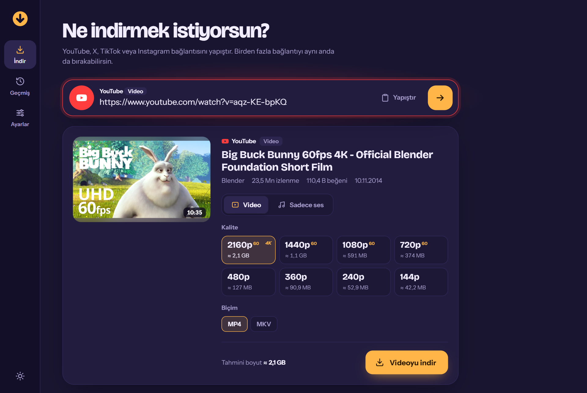
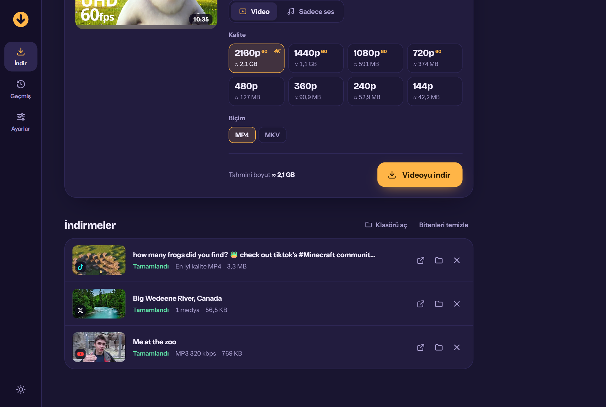
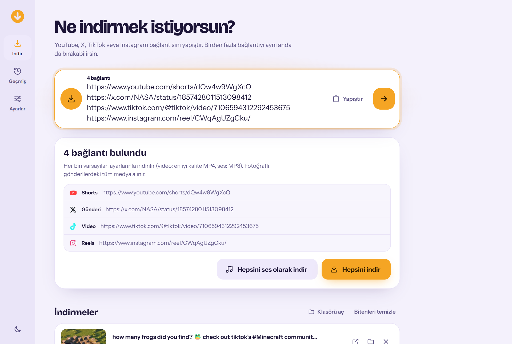
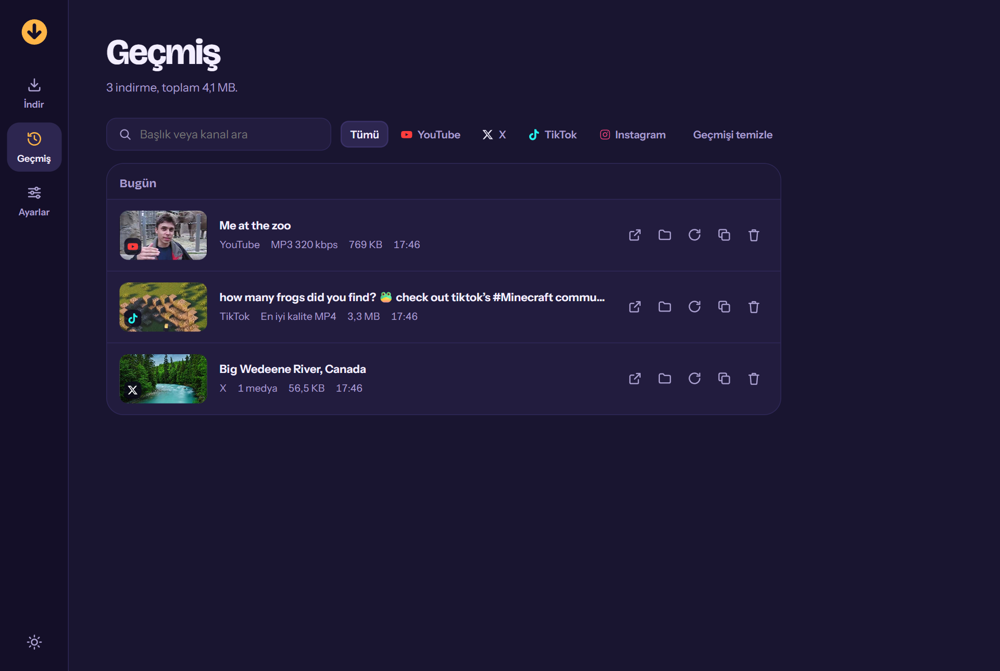
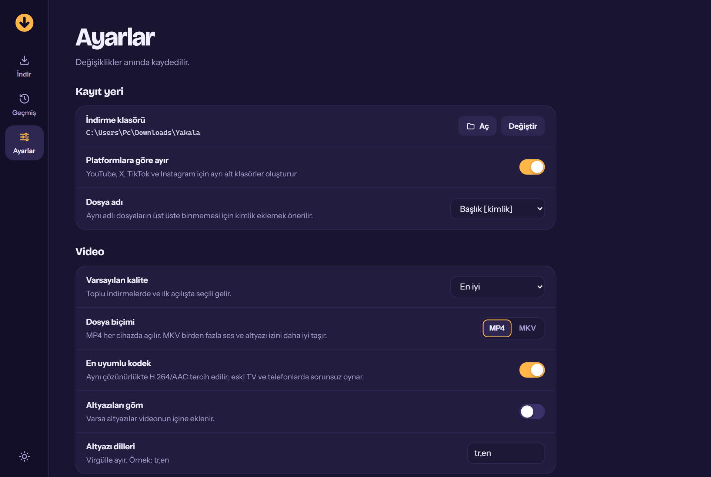

# Yakala

YouTube, X (Twitter), TikTok ve Instagram'dan video, ses ve fotoğraf indiren masaüstü uygulaması.
Bağlantıyı yapıştırırsın, Yakala ne olduğunu anlar, sana kalite seçeneklerini gösterir ve indirir.

**[⬇ Son sürümü indir (Windows)](https://github.com/furkibayashi/Yakala/releases/latest)**



## Neleri indirir?

| Platform  | İçerik |
|-----------|--------|
| YouTube   | Video, Shorts, oynatma listesi (seçerek), sadece ses (MP3/M4A/OPUS/FLAC/WAV), 4K/8K'ya kadar |
| X         | Video, GIF, fotoğraflar (çoklu fotoğraflı gönderiler dahil) |
| TikTok    | Video, fotoğraf slaytları, sadece ses |
| Instagram | Reels, gönderi (karışık fotoğraf/video carousel), hikâye, öne çıkanlar |

Bunların dışında yt-dlp'nin desteklediği yüzlerce site de "Diğer site" olarak çalışır.

## Özellikler

- **Akıllı bağlantı tanıma:** yapıştırdığın anda platform ve içerik türü (Shorts, Reels, Hikâye…) görünür.
- **Kalite seçimi:** mevcut her çözünürlük tahmini dosya boyutuyla listelenir; MP4/MKV seçimi, altyazı ekleme.
- **Sadece ses:** MP3, M4A, OPUS, FLAC, WAV; 128–320 kbps; kapak görseli ve etiketler dosyaya gömülür.
- **Galeri seçimi:** fotoğraflı gönderilerde hangi görselleri istediğini tek tek seçebilirsin.
- **Oynatma listeleri:** listedeki videoları tek tek işaretleyip indir.
- **Toplu indirme:** birden fazla bağlantıyı aynı anda yapıştır, hepsi kuyruğa girsin.
- **Kuyruk:** aynı anda 1–6 indirme, duraklat / devam et / iptal / tekrar dene, hız ve kalan süre.
- **Geçmiş:** arama, platform filtresi, dosyayı aç, klasörde göster, yeniden indir.
- **Pano izleme:** bir bağlantı kopyalayıp uygulamaya döndüğünde önerir.
- **Sürükle bırak:** tarayıcıdan bir bağlantıyı pencereye sürükle.
- **Koyu / açık tema**, platformlara göre klasörleme, dosya adı şablonları, hız sınırı, proxy.

## Ekran görüntüleri

| İndirme kuyruğu | Toplu indirme (açık tema) |
|---|---|
|  |  |
| **Geçmiş** | **Ayarlar** |
|  |  |

## Kurulum

### Hazır uygulama (önerilen)

1. [Releases](https://github.com/furkibayashi/Yakala/releases/latest) sayfasından `Yakala-…-windows.zip` dosyasını indir.
2. Zip'i istediğin bir klasöre çıkar.
3. `Yakala.exe` dosyasını çalıştır. Python kurmana gerek yok.

Windows SmartScreen "tanınmayan uygulama" uyarısı verirse **Ek bilgi → Yine de çalıştır** de.
Uygulama imzalı olmadığı için bu uyarı normaldir.

Gereksinim: Windows 10/11 (64 bit). Arayüz için Microsoft Edge WebView2 kullanılır; Windows 11'de hazır gelir.

### Kaynak koddan çalıştırma

1. Python 3.10 veya üstü kurulu olmalı.
2. `kur.bat` dosyasına çift tıkla (ya da `py -m pip install -r requirements.txt`).
3. `Yakala.pyw` dosyasına çift tıkla.

`build.bat` aynı uygulamayı `dist\Yakala\Yakala.exe` olarak derler.

FFmpeg ayrıca kurmana gerek yok; uygulamayla birlikte gelir. Ayarlar → Sistem bölümünden
tek tıkla tam sürüme (ffprobe dahil) yükseltebilirsin.

## Kısayollar

| Tuş | İş |
|-----|----|
| `Ctrl+V` (her yerde) | Panodaki bağlantıyı yapıştırıp inceler |
| `Enter` | Bağlantıyı incele |
| `Esc` | Alanı temizle |
| `/` veya `Ctrl+L` | Bağlantı alanına git |
| `Alt+1/2/3` | İndir / Geçmiş / Ayarlar |

## Instagram hikâyeleri ve giriş gerektiren içerikler

Instagram hikâyeleri, gizli hesaplar, yaş sınırlı YouTube videoları ve "bot olmadığını doğrula"
uyarıları için giriş yapmış olman gerekir. **Ayarlar → Hesap çerezleri**:

- **Tarayıcıdan:** Instagram'a/YouTube'a giriş yaptığın tarayıcıyı seç. Firefox en sorunsuz olanıdır.
  Chrome ve Edge çalışırken çerez veritabanını kilitler; okunamazsa tarayıcıyı tamamen kapat.
- **cookies.txt:** "Get cookies.txt LOCALLY" gibi bir eklentiyle dışa aktardığın dosyayı seç.

Çerezler bilgisayarından dışarı gönderilmez; yalnızca ilgili siteye istek yapılırken kullanılır.

## Bir şey indirilemiyorsa

Platformlar sık sık değişiklik yapar.

- **Hazır uygulamada:** Releases sayfasından son sürümü indir; motorlar her sürümde güncellenir.
- **Kaynak koddan çalıştırıyorsan:** **Ayarlar → Sistem → Güncelle** ile indirme motorlarını
  (yt-dlp, gallery-dl) güncelle ve uygulamayı yeniden başlat.

Sorun devam ederse bağlantıyla birlikte bir [issue](https://github.com/furkibayashi/Yakala/issues) aç.

## Dosyalar nerede?

- İndirmeler: varsayılan olarak `İndirilenler\Yakala\<Platform>\`
- Ayarlar ve geçmiş: `%APPDATA%\Yakala\`

## Nasıl çalışır?

`Yakala.pyw` yalnızca `127.0.0.1` üzerinde dinleyen küçük bir yerel sunucu başlatır ve arayüzü
bir masaüstü penceresinde (WebView2) açar. Videolar [yt-dlp](https://github.com/yt-dlp/yt-dlp),
fotoğraflar ve karışık gönderiler [gallery-dl](https://github.com/mikf/gallery-dl) ile çözülür.

```
yakala/
  __main__.py   pencere, yardımcı kipler (klasör seçici, gallery-dl)
  server.py     yerel HTTP + JSON API (rastgele erişim anahtarıyla korunur)
  engine.py     bağlantı analizi, kuyruk, indirme işleri
  platforms.py  platform ve içerik türü tanıma
  tools.py      ffmpeg/deno, pano, hata mesajlarının Türkçeleştirilmesi
  config.py     ayarlar ve geçmiş
  web/          arayüz (HTML/CSS/JS)
```

## Lisans

[MIT](LICENSE)

## Not

Yalnızca indirme hakkına sahip olduğun içerikleri indir ve platformların kullanım koşullarına uy.
